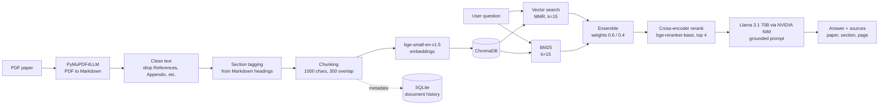

# ScholarRAG

**Ask questions about a library of research papers and get answers that cite the paper, section and page they came from.**


ScholarRAG is a retrieval-augmented generation (RAG) system over 19 machine-learning and RAG papers (Transformer, BERT, DPR, RAG, GPT-3, LoRA, Llama 2, Self-RAG, RAGAS and others). It turns PDFs into section-aware chunks, retrieves with hybrid search (dense vectors plus BM25), reranks with a cross-encoder and generates a grounded answer with Llama 3.1 70B. I evaluated it with RAGAS on 100 hand-written questions.

Case study: [mohvijayjain.github.io/projects/scholarrag.html](https://mohvijayjain.github.io/projects/scholarrag.html)

## How it works



1. **Ingestion** (`app/core/ingest.py`): each PDF is loaded page by page as Markdown. `clean_text` cuts everything after a References, Acknowledgments, Appendix or Broader Impact heading on that page. Every page gets a `section` taken from the last Markdown heading seen so far, plus `document_id`, `paper_name`, `page` and `upload_date` metadata.
2. **Chunking**: `RecursiveCharacterTextSplitter` (chunk size 1000, overlap 300) splits on Markdown headings first, then paragraphs, lines and words.
3. **Indexing**: chunks are embedded with `BAAI/bge-small-en-v1.5` and stored in ChromaDB (`database/chroma_db`). A SQLite table (`database/documents.db`) records each document, its chunk count and status.
4. **Retrieval** (`app/core/rag_pipeline.py`): an `EnsembleRetriever` combines Chroma MMR search (k=15) and BM25 (k=15) with weights 0.6/0.4. Questions can be limited to chosen papers through `document_id` filters. If BM25 has no matching chunks, it falls back to vector search alone.
5. **Reranking**: the `BAAI/bge-reranker-base` cross-encoder scores every candidate and keeps the top 4.
6. **Generation**: `meta/llama-3.1-70b-instruct` through `ChatNVIDIA` (temperature 0.2, up to 1024 tokens). Rate-limit (429) and connection errors are retried with exponential backoff (5s doubling, 60s cap, 6 attempts).
7. **Grounding**: the prompt tells the model to use only the retrieved context, to name the paper and section, and to reply *"I could not find this information in the provided documents."* when the answer is not there. `/chat` also returns structured sources (paper, section, page).

## Evaluation results

`evaluation/test_dataset.json` has 100 hand-written questions with reference answers in five categories: concept (41), architecture (20), implementation (15), comparison (14) and evaluation (10). `evaluation/ragas_eval.py` runs the full pipeline on each question and scores it with RAGAS. Llama 3.1 70B on NVIDIA NIM is the judge and `nvidia/nv-embedqa-e5-v5` provides the embeddings. It runs in batches of 5 with cooldowns and skips batches that already have results, so an interrupted run can resume.

| Metric | Score | Questions scored |
|---|---|---|
| Faithfulness | **0.80** | 46 / 98 |
| Context precision | **0.71** | 63 / 98 |
| Context recall | **0.70** | 88 / 98 |
| Answer relevancy | **0.52** | 81 / 98 |

> **Honest note.** These were run on NVIDIA's free tier. Two of the 100 questions failed during answer generation (API read timeouts, logged in `failed_questions.jsonl`), leaving 98 answered questions. Within those, some judge calls timed out, so each metric was scored on a different number of questions. Unscored (NaN) values are left out of each average. Faithfulness has the smallest sample (46 questions), so treat it as an indication, not a final number. Answer relevancy is clearly the weakest metric and is the first thing on the roadmap.

## Quickstart

Requires **Python 3.10+** (the code uses `list[str] | None` type syntax; developed on 3.12). The first run downloads the embedding and reranker models from Hugging Face.

```bash
git clone https://github.com/mohvijayjain/ScholarRAG.git
cd ScholarRAG
python -m venv venv
# Windows: venv\Scripts\activate    macOS/Linux: source venv/bin/activate
pip install -r requirements.txt
```

Create a `.env` file in the project root. Only variable names are shown here; use your own values.

```env
NVIDIA_API_KEY=        # required: NVIDIA NIM key for Llama 3.1 70B (generation and RAGAS judge)
HF_TOKEN=              # optional: avoids Hugging Face rate limits when downloading models
SCHOLARRAG_API_URL=    # optional: API URL used by the Streamlit UI (default http://127.0.0.1:8000)
```

**Index the papers.** PDFs in `data/` are not committed, so add your own and index them once. Re-running this adds duplicate chunks.

```bash
python -c "from app.core.ingest import ingest_all_documents; ingest_all_documents()"
```

Index at least one paper before starting the API, because the BM25 retriever is built from the existing chunks at startup.

**Run the API and the UI** from the project root:

```bash
uvicorn app.api.main:app --reload          # http://127.0.0.1:8000 (docs at /docs)
streamlit run app/ui/streamlit_app.py      # in a second terminal
```

**Run the evaluation** (slow by design because of rate limits; results go to `evaluation/batch_results_fixed/`):

```bash
python evaluation/ragas_eval.py
```

## API

| Method | Endpoint | Description |
|---|---|---|
| `GET` | `/` | Health check |
| `POST` | `/chat` | Body `{"question": str, "document_ids": [str] \| null}`. Returns `{"answer", "sources": [{"paper", "section", "page"}]}` |
| `GET` | `/documents` | Lists indexed documents (id, filename, chunk count, upload date, status) |
| `POST` | `/upload` | Multipart PDF upload. Copies it to `data/`, indexes it, and skips filenames that are already indexed |

## Project structure

```
ScholarRAG/
├── app/
│   ├── api/            # FastAPI app, request/response schemas, routes (chat, documents, upload)
│   ├── core/           # ingestion, RAG pipeline, SQLite models, upload and document managers
│   └── ui/             # Streamlit front end
├── data/               # source PDFs (git-ignored)
├── database/           # ChromaDB store and SQLite document history (generated)
├── evaluation/         # 100-question test set, RAGAS scripts, batch results
├── scripts/            # database checks and manual pipeline tests
└── requirements.txt
```

## Design decisions

- **Hybrid retrieval over vector-only.** Papers are full of exact terms (model names, metric names, acronyms such as DPR or LoRA) that BM25 matches better than dense embeddings, while embeddings handle paraphrased questions. The ensemble leans toward dense search (0.6/0.4).
- **Retrieve wide, then rerank narrow.** Up to 30 candidates come back cheaply. A cross-encoder then reads each question and chunk together and keeps only 4, so the LLM gets a short, relevant context.
- **Markdown-aware ingestion.** Converting PDFs to Markdown keeps the heading structure. That structure drives both the chunk boundaries and the `section` metadata used in citations, and it makes it easy to remove References and Appendix sections that would otherwise add noise to retrieval.
- **Small, local embedding model.** `bge-small-en-v1.5` runs on a CPU and keeps indexing free. The paid, hosted model is used only for generation.
- **Built to survive a free tier.** Backoff on 429 and connection errors, plus a batched evaluation that resumes where it stopped, made it possible to run 100 questions against a rate-limited API.

## Roadmap

- **Improve answer relevancy (0.52):** tighten the prompt so answers address the question directly before adding background.
- **Ablation study:** compare vector-only, hybrid, and hybrid plus reranker on the same 100 questions to measure what each stage adds.
- **Post-generation faithfulness check:** verify each claim in the answer against the retrieved chunks before returning it, instead of relying only on prompt rules.
- Rebuild the global BM25 index after uploads. It is currently built once at startup, so papers uploaded later are found through vector search or document filters until the API restarts.

## Author

**Mohvijay Jain**, B.Tech CSE (Data Science), Bennett University

- Portfolio: [mohvijayjain.github.io](https://mohvijayjain.github.io/) · [ScholarRAG case study](https://mohvijayjain.github.io/projects/scholarrag.html)
- LinkedIn: [linkedin.com/in/mohvijayjn](https://www.linkedin.com/in/mohvijayjn/)
- GitHub: [github.com/mohvijayjain/ScholarRAG](https://github.com/mohvijayjain/ScholarRAG)
